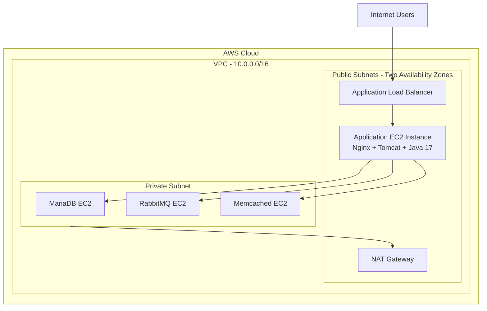

# AWS Multi-Tier Application Deployment | Terraform & Ansible


An AWS-based multi-tier Java web application infrastructure provisioned using **Terraform** and configured using **Ansible**.

The project demonstrates Infrastructure as Code (IaC), configuration management, network segmentation, load balancing, and automated deployment of a multi-tier application.

---

## Table of Contents

- [Project Overview](#project-overview)
- [Architecture](#architecture)
- [Technology Stack](#technology-stack)
- [AWS Infrastructure](#aws-infrastructure)
- [Application Components](#application-components)
- [Repository Structure](#repository-structure)
- [Deployment Workflow](#deployment-workflow)
- [Security Design](#security-design)
- [Validation](#validation)
- [Cost Management](#cost-management)
- [Future Improvements](#future-improvements)

---

## Project Overview

This project deploys a Java-based multi-tier web application on AWS.

The infrastructure is provisioned using Terraform, while Ansible automates server configuration and application deployment.

The architecture separates the application tier from the backend services, using private networking and security groups to restrict access.

### Key Objectives

- Provision AWS infrastructure using Terraform.
- Automate server configuration using Ansible roles.
- Deploy a Java web application on Apache Tomcat.
- Configure Nginx as a reverse proxy.
- Deploy MariaDB, RabbitMQ, and Memcached on separate backend instances.
- Expose the application through an Application Load Balancer.
- Manage sensitive configuration using Ansible Vault.

---

## Architecture



### Request Flow

1. Users access the application through the public Application Load Balancer.
2. The ALB forwards HTTP traffic to the application EC2 instance.
3. Nginx receives incoming requests and acts as a reverse proxy.
4. Apache Tomcat serves the Java web application.
5. The application communicates with the backend services:
   - MariaDB for database operations.
   - RabbitMQ for messaging.
   - Memcached for caching.

---

## Technology Stack

| Category | Technologies |
|---|---|
| Cloud Provider | AWS |
| Infrastructure as Code | Terraform |
| Configuration Management | Ansible |
| Compute | Amazon EC2 |
| Networking | VPC, Public & Private Subnets |
| Load Balancing | Application Load Balancer |
| Network Security | Security Groups |
| Outbound Connectivity | Internet Gateway, NAT Gateway |
| Operating System | Ubuntu 22.04 |
| Web Server | Nginx |
| Application Server | Apache Tomcat |
| Runtime | Java 17 |
| Database | MariaDB |
| Messaging | RabbitMQ |
| Caching | Memcached |
| Secrets Management | Ansible Vault |

---

## AWS Infrastructure

Terraform provisions the following resources:

| Resource | Purpose |
|---|---|
| VPC | Isolated AWS network |
| Public Subnets | Host the ALB and application server |
| Private Subnet | Host backend services |
| Internet Gateway | Internet connectivity for public resources |
| NAT Gateway | Outbound internet access for private resources |
| EC2 Instances | Application and backend servers |
| Security Groups | Control inbound and outbound traffic |
| Application Load Balancer | Distribute incoming HTTP traffic |
| Target Group | Register the application instance |
| Health Check | Monitor application endpoint availability |

### EC2 Deployment

Four EC2 instances are deployed:

- **Application Server:** Nginx, Tomcat, and Java.
- **MariaDB Server:** Application database.
- **RabbitMQ Server:** Message broker.
- **Memcached Server:** In-memory caching.

---

## Application Components

### Application Tier

- Nginx handles incoming HTTP requests.
- Tomcat runs the Java application.
- Java 17 provides the application runtime.

### Backend Tier

- MariaDB stores application data.
- RabbitMQ provides messaging services.
- Memcached provides caching capabilities.

Each backend service runs on a dedicated EC2 instance in the private subnet.

---

## Repository Structure

```text
terraform-ansible-aws-multitier/
│
├── terraform/
│   ├── main.tf
│   ├── variables.tf
│   ├── outputs.tf
│   └── .terraform.lock.hcl
│
├── ansible/
│   ├── site.yml
│   ├── roles/
│   │   ├── common/
│   │   ├── app/
│   │   ├── mariadb/
│   │   ├── rabbitmq/
│   │   └── memcached/
│   │
│   ├── group_vars/
│   │   └── all/
│   │
│   └── inventory.ini.example
│
├── .gitignore
└── README.md
```

---

## Deployment Workflow

### 1. Clone the Repository

```bash
git clone https://github.com/omarnasser270/terraform-ansible-aws-multitier.git

cd terraform-ansible-aws-multitier
```

### 2. Provision AWS Infrastructure

Configure the required Terraform variables, then initialize Terraform:

```bash
cd terraform

terraform init
terraform validate
terraform plan
terraform apply
```

### 3. Configure Ansible

Prepare the inventory file and configure the required Ansible variables.

Create the encrypted secrets file using Ansible Vault.

### 4. Configure the Servers and Deploy the Application

```bash
cd ../ansible

ansible-playbook -i inventory.ini site.yml --ask-vault-pass
```

### 5. Access the Application

Retrieve the ALB DNS name:

```bash
cd ../terraform

terraform output alb_dns_name
```

Open the returned DNS address in your browser using HTTP.

---

## Security Design

The project applies network-level access restrictions:

- The ALB accepts HTTP traffic from the internet.
- The application server accepts HTTP traffic from the ALB security group.
- SSH access to the application server is restricted to the administrator's CIDR.
- Backend service ports are accessible only from the application server security group.
- Backend EC2 instances do not require public IP addresses.
- Ansible Vault is used to protect sensitive application credentials.
- Sensitive files such as inventory files, Terraform variables, and private keys are excluded from version control.

**Important:** Never commit actual credentials, private keys, unencrypted Vault files, or environment-specific inventory data.

---

## Validation

The deployment was validated through:

- Successful Terraform provisioning.
- Successful Ansible playbook execution.
- Application server HTTP response verification.
- Application Load Balancer target health checks.
- Browser access through the ALB DNS endpoint.
- Successful application login.

---

## Cost Management

This project uses AWS resources that may incur charges, including:

- EC2 instances.
- Application Load Balancer.
- NAT Gateway.
- Elastic IP.
- Data transfer.

When the environment is no longer needed, destroy the Terraform-managed infrastructure:

```bash
cd terraform

terraform destroy
```

Review the Terraform plan carefully before confirming destruction.

---

## Future Improvements

- Implement CI/CD using Jenkins or GitHub Actions.
- Introduce monitoring with Prometheus and Grafana.
- Add centralized logging.
- Implement HTTPS using ACM and an Application Load Balancer listener.
- Improve infrastructure availability and scalability.
- Add automated infrastructure and configuration testing.

---

## Author

**Omar Nasser**

DevOps Engineer | AWS | Terraform | Ansible | Docker | Kubernetes

[GitHub Profile](https://github.com/omarnasser270)

[Project Repository](https://github.com/omarnasser270/terraform-ansible-aws-multitier)
